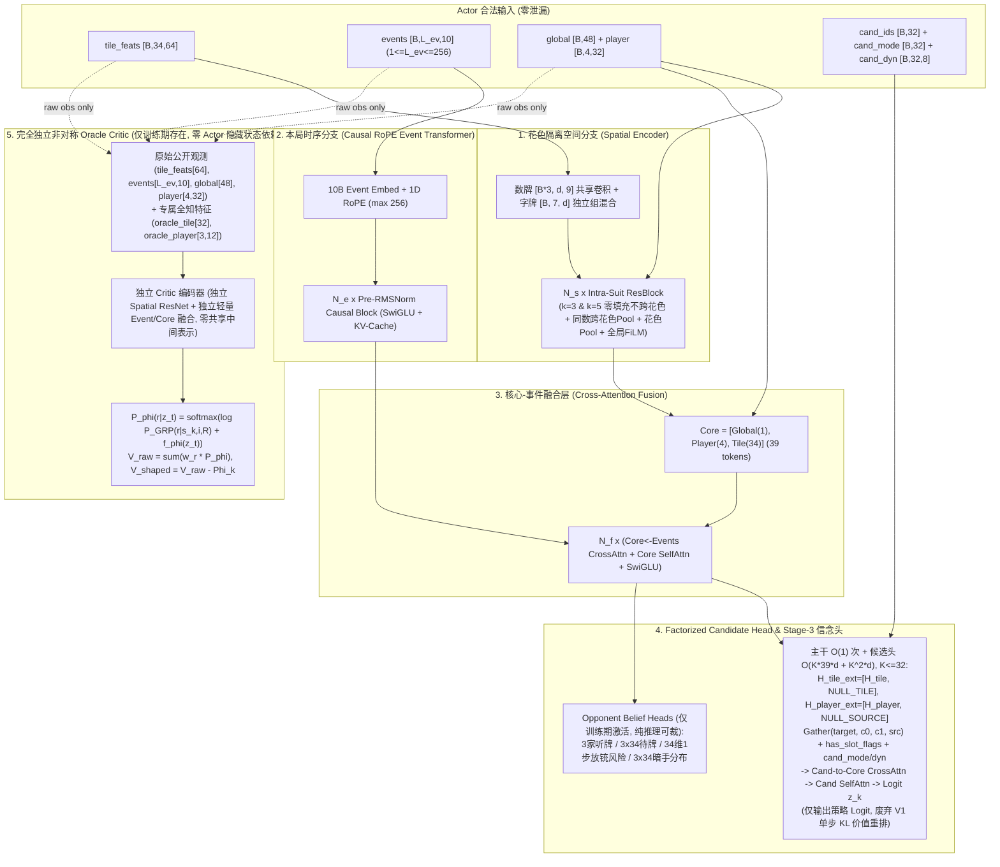

# KAR V2 Token 与 Hybrid 模型架构工程合同（v2.5 · Stage 1 Complete）

> **文档状态**：Stage 1 实施完成与二次独立审查基线（v2.5：完成 Stage 1 全部 Rust 特征引擎、PyO3 零拷贝接口、PyTorch V2 模型/GRP/Belief/Stage-4 RL 合同原语、在线 vs MJAI 回放零 Train-Serve Skew 实证及本地 CPU 实测 Benchmark）  
> **适用范围**：`riichienv-core`（Rust 特征与规则引擎）、`riichienv-python`（PyO3 零拷贝绑定）、`src/riichienv/kar/v2`（V2 模型、GRP 校准、Belief 损失与 Stage-4 RL 合同原语）  
> **实施原则**：旧 KAR V1 模型/训练代码与历史文档已从活动分支 `kar/v2-stage1` 清理移除（保留共用的动作映射/规则特征/回放基础模块；如需回溯 V1 基线可从 Git 历史检出）；不以理论估算替代实测 Benchmark；严禁在通过前置门控（及云端 GPU 吞吐实测）前投入大规模训练预算。

---

## 0. 不可违反的核心不变量（Contract Invariants）

1. **信息严格隔离与双编码器完全独立（Zero Leakage & Stationary Critic）**：Actor 推理路径仅接收当前决策者合法可见的公开与己方暗手信息；对手暗手、剩山构成、真实里宝牌、对手真实待牌及即时放铳真值**仅允许进入训练期 Oracle Critic 与 Stage 3 辅助监督标签**（Rust 侧仅在 `&GameState` 上可调用，编译期隔离于 `&Observation`）。Actor 与 Oracle Critic **仅共享原始观测输入张量，严禁共享任何动态更新的中间隐藏表示**，推理导出的 Actor 权重在模块结构上不包含 Critic。
2. **动作空间精确可逆与候选上限守卫（Exact 546-Action Bijection & `MAX_CANDIDATES = 32`）**：严格绑定 `src/riichienv/kar/actions.py` 中的 `ACTION_MANIFEST`（`ACTION_COUNT = 546`, `MAX_CANDIDATES = 32`）与 `ACTION_MANIFEST_SHA256`，保留赤 5、摸切/手切、立直/默听、吃/碰具体消耗牌组合及鸣牌来源；所有候选列表严格按 `global_id` 升序规范化排列，Rust 侧强制 `assert!(legal_actions.len() <= MAX_CANDIDATES)`（超限硬报错，永不截断）。
3. **单一物理可见牌真值源（Physical Tile Deduplication）**：所有可见枚数、剩牌枚数、壁（Kabe）与有效进张计算必须共享同一个物理牌去重结构体 `VisibleTileCounts`（含加杠回溯原碰河牌去重与非法孤立 `called_tile` 校验），严禁将河牌与副露中的鸣走牌重复计数。
4. **观察者可见事件流严格无损（Lossless Observer-Visible Event Stream）**：本局事件流采用严格只追加（Append-Only）的动态长度张量，**无损性精确限定于当前观察者合法可见事件流**（`CanonicalObserverVisibleEvents`：桌面公开事件 + 观察者自己的 `TSUMO_SELF` 与 `SELF_PASS`，**严格不包含**对手私人摸牌、对手私人放弃响应、牌山发牌序或暗王牌等内部隐藏事件）；**禁止静默截断或丢弃任何事件**；RoPE 位置上界为 `256`（单局组合上界 $\le 214 < 256$），超出 `256` 直接抛出硬错误。
5. **在线推演与离线回放零训练-推理偏差（Zero Train-Serve Skew）**：`GameState` 原生内嵌 `v2_round_events: RoundEventLog` 与 `v2_hanchan_tracker: HanchanTracker`，在在线对局 `step()`、MJAI 回放 `apply_mjai_event()` 与牌谱日志回放 `apply_log_action()` 三条路径上共享同一单调舍牌序 `v2_discard_seq`、一致的优先权可证明 `SelfPassPrivate` 规则、幂等局末结算守卫 `v2_round_settled` 与统一 `v2_round_global_context()`，严禁训练预处理与在线推理维护两套不同事件/跨局状态机。
6. **牌理特征只作输入，不作优化标签**：Rust 向听/进张特征仅作为状态辅助输入，绝不替代真实对局策略或终局顺位回报。
7. **策略优化机制明确迁移（Deprecating V1 Reranking）**：**KAR V2 明确废弃 V1 的单步 KL 价值重排** $\pi_\tau(a|x)\propto\pi_0(a|x)\exp(Q(x,a)/\tau)$。V2 Actor 直接输出候选策略 Logit $z_k$，Oracle Critic 仅输出状态价值 $V_\phi(z_t)$（非动作价值 $Q(s,a)$），Stage 4 统一通过带 Critic Warmup 门控、冻结 GAE Target 与 PFSP 历史对手池（含必选冻结 BC 锚点）的 PPO/IMPALA 优化动作分布，严禁将 $V_\phi$ 误作候选重排 $Q$ 值。
8. **所有性能与棋力主张以实测为准**：本地已测指标（参数量、单核 Rust 编码延迟）按实测如实披露；云端 GPU 吞吐、显存峰值、压缩牌谱存储占用及对 Mortal 胜率继续标记为**待云端实测**，在对应 Stage 实测后补录。

---

## 一、Token 与张量输入契约（Rust Zero-Copy → PyTorch）

每个决策步由 **5 组 Actor 合法张量**与 **2 组训练期专属 Oracle 张量**组成（Critic 仅读取原始输入张量，不依赖 Actor 任何隐藏层输出）：

| 张量名 | 形状与 dtype | 可见范围 | 说明 |
| :--- | :--- | :--- | :--- |
| `tile_feats` | `[B, 34, 64]` `fp16/bf16` | Actor + Critic | 34 牌牌面、对手纯公开牌河安全度、物理去重可见计数、Rust 精确牌效 |
| `events` / `event_len` | `[B, L_ev, 10]` `uint8` / `[B]` `int16` | Actor + Critic | 本局严格无损、只追加的**观察者可见事件流**（动态批内对齐，`1 ≤ L_ev ≤ 256`） |
| `global_feats` | `[B, 48]` `fp16/bf16` | Actor + Critic | 场况、决策阶段、完整 `GameRule` 开关与归一化配分向量 |
| `player_feats` | `[B, 4, 32]` `fp16/bf16` | Actor + Critic | 4 相对席位本局即时状态 + 跨局半庄行为摘要 |
| `cand_ids` / `cand_mask` / `cand_mode` / `cand_dyn` | `[B, 32]` `int16` / `bool` / `uint8` / `[B, 32, 8]` `fp16` | Actor | 升序排列的合法 546 动作 ID + 7 类互斥语义动态特征 |
| *(仅训练)* `oracle_tile` | `[B, 34, 32]` `fp16/bf16` | **仅 Critic** | 对手暗手、剩山分布（置换不变）、真实里宝、对手真实待牌/进张 |
| *(仅训练)* `oracle_player` | `[B, 3, 12]` `fp16/bf16` | **仅 Critic** | 3 家对手真实向听、听牌、打点上限与活山剩余待牌枚数 |

---

### 1.1 物理可见牌统一计数合同（解决 P0-2）

在 `riichienv-core` 中定义唯一真值结构体 `VisibleTileCounts`：

- 依据物理牌编号 `tile136 ∈ [0, 135]`（赤 5m=`16`、赤 5p=`52`、赤 5s=`88`）构建去重位图 `seen_136: [bool; 136]`，合并四个集合：`hands[self]`、`discards[0..4]`、`melds[0..4].tiles`、`dora_indicators`。
- 同时满足精确代数恒等式（对每个 `base34` 牌种 $t \in [0, 33]$）：
  $$V_t = R_t + M_t - C_t + D_t, \qquad U_t = 4 - H_t - V_t$$
  其中：
  - $H_t$：己方暗手牌张数；
  - $R_t$：四家河牌记录中的总张数（含已被鸣走记录）；
  - $M_t$：四家所有副露（吃/碰/大明杠/加杠/暗杠）中的总张数；
  - $C_t$：已从河牌转入他家副露的鸣走牌张数（即 `meld.called_tile.is_some()` 对应的被鸣走物理牌；暗杠 `called_tile = None` 不扣除，加杠保留原碰的单一 `called_tile` 不重复扣除）；
  - $D_t$：已公开亮出的宝牌指示牌张数。
- **硬不变量**：`seen_136` 聚合结果必须与 $H_t + V_t$ 逐牌种完全一致，且满足 $0 \le H_t + V_t \le 4$；赤 5 未见标记精确为 `[!seen_136[16], !seen_136[52], !seen_136[88]]`。所有防御（壁）与牌效（可见扣除有效进张）**强制消费同一 `VisibleTileCounts` 实例**。

---

### 1.2 `tile_feats: [B, 34, 64]` — 逐通道冻结表（解决 P0-1 & P0-2）

`base34` 索引：`0..8`=1m..9m，`9..17`=1p..9p，`18..26`=1s..9s，`27..33`=东南西北白发中。数牌专属特征（筋/早外/壁/宝牌邻接）对字牌统一填 `0.0`。

#### Group A：己方手牌、宝牌与物理去重可见枚数（19 通道：`[0..18]`）
| 通道 | 名称 | 精确定义 |
| :--- | :--- | :--- |
| `0..3` | `self_closed_cnt_ge{1,2,3,4}` | 己方暗手 $H_t \ge \{1,2,3,4\}$ 温度计编码 $\in\{0,1\}$ |
| `4` | `self_closed_has_red5` | 己方暗手持有物理赤 5（仅 `4/13/22` 位可为 1） |
| `5..8` | `self_meld_cnt_ge{1,2,3,4}` | 己方全部副露中该 `base34` 牌张数 $\ge \{1,2,3,4\}$ |
| `9..10` | `self_last_tsumo` / `self_last_tsumo_is_red5` | `OWN_ACT` 摸牌后的刚摸入牌及赤 5 标记（吃/碰后及 `*_RESP` 阶段为 `0`） |
| `11` | `kuikae_forbidden` | 当前 `OWN_ACT` 是否受食替规则禁切 |
| `12` | `dora_value_norm` | 所有已亮出宝牌指示牌对该牌叠加的宝牌数 `/ 4.0`（截断至 `[0,1]`） |
| `13` | `red5_unseen` | 来自 `VisibleTileCounts.red5_unseen`（仅 `4/13/22` 位可为 1） |
| `14..17` | `unseen_cnt_ge{1,2,3,4}` | 来自 `VisibleTileCounts.unseen_base34` 的 $U_t \ge \{1,2,3,4\}$ 温度计编码 |
| `18` | `self_discarded_ever` | 己方本局河牌中曾切过该牌（含被他家鸣走的舍牌，用于精确振听判定） |

#### Group B1：3 家对手公开河牌、筋安全与副露（27 通道：`[19..45]`，按相对席位 `p ∈ {1=下家, 2=对家, 3=上家}` 各 9 通道）

> **P0-1 严格可观测性合同**：全面删除 `opp_post_riichi_passed` 与 `opp_same_turn_passed`（禁止将“他家切牌后未发生荣和”推断为对手私人弃荣响应）。以下全部通道**严格仅由对手 `p` 自身公开牌河与副露直接导出**，零私人状态推断：

偏移 `off = 19 + (p - 1) * 9`：
| 相对偏移 | 名称 | 精确定义（严格基于对手 `p` 自身公开牌河与副露） |
| :--- | :--- | :--- |
| `+0` | `opp_own_river_genbutsu` | 对手 `p` **自己本局曾切出**的牌（含被鸣走舍牌）——100% 公开确定现物 |
| `+1` | `opp_riichi_declare_tile` | 对手 `p` 公开横置的立直宣言牌位置（未立直或非此牌为 `0`，100% 公开可观测） |
| `+2` | `opp_last_discard_tile` | 对手 `p` 河牌中最新一枚舍牌位置（河牌为空时全 `0`，100% 公开可观测） |
| `+3` | `opp_suji_one_side` | 数牌中至少一侧关联筋牌属于 `opp_own_river_genbutsu(p)`（严格仅由 `p` 自切河牌推导，字牌 `0`） |
| `+4` | `opp_suji_full` | 全部关联筋牌均属于 `opp_own_river_genbutsu(p)`（对齐 `rule_features.full_suji_exclusion`，字牌 `0`） |
| `+5` | `opp_early_discard_shape_hint` | **早巡舍牌牌形提示（严禁视作安全关系，绝不纳入现物或筋集合）**。启用时的精确公式：若 `p` 前 6 枚自切舍牌中存在同花色数牌 $r_d \in \{2,3,4\}$ 且 $1 \le r < r_d$，或 $r_d \in \{6,7,8\}$ 且 $r_d < r \le 9$，则置 `1.0`（$r=5$ 与字牌恒为 `0`）。**Stage 1–2 默认配置 `enable_early_shape_hint = false`（该通道填 `0.0`），后续通过独立消融决定是否开启** |
| `+6` | `opp_discard_recency` | 距 `p` 最近一次自切该牌经过的河巡数衰减 $\exp(-\Delta t / 6)$（未切过为 `0`） |
| `+7` | `opp_last_discard_tedashi` | `p` 最近一次自切该牌是否为手切 |
| `+8` | `opp_meld_cnt_norm` | `p` 副露中该 `base34` 牌张数 `/ 4.0` |

#### Group B2：公共结构防御与役牌（8 通道：`[46..53]`）
| 通道 | 名称 | 精确定义 |
| :--- | :--- | :--- |
| `46` | `kabe_no_chance` | 基于 `VisibleTileCounts`（$H_t + V_t = 4$）封死该牌所有两面搭子（对齐 `no_visible_possible_ryanmen_shape`） |
| `47` | `kabe_one_chance` | 所有两面搭子均至少有一端满足 $H_t + V_t \ge 3$，且不满足 `kabe_no_chance` |
| `48..49` | `dora_adj_dist1` / `dora_adj_dist2` | 同花色距当前宝牌距离为 1 / 2 的数牌 |
| `50` | `yakuhai_self_norm` | 对己方的役牌权重：`0.0`（非役牌）/ `0.5`（三元或单风）/ `1.0`（连风） |
| `51..53` | `yakuhai_opp_norm[1..3]` | 对 3 家对手各自的役牌权重 |

*(注：常量静态属性 `is_yaochuu`/`is_simple` 由模型入层固定的 `SuitEmb + RankEmb` 无损表征，无需占用动态特征通道。)*

#### Group C：Rust 精确向听与进张特征（10 通道：`[54..63]`，严格只作输入）
- `OWN_ACT` 阶段填充 `[54..61]`，`[62..63]` 置 `0`；`*_RESP` 阶段 `[54..61]` 置 `0`，填充 `[62..63]`。
- 同时持有赤 5 与普 5 时两者 `base34` 相同、向听与进张完全一致，其宝牌差异在 `cand_dyn` 与 `ACTION_MANIFEST.target_is_red5` 精确区分。

| 通道 | 名称 | 精确定义 |
| :--- | :--- | :--- |
| `54` | `is_legal_discard` | 是否存在合法 `DISCARD` 候选对应 `base34 == i` |
| `55` | `discard_shanten_gap_0` | 合法切牌且切 `i` 后向听等于本手合法最小向听 $s^*$ |
| `56` | `discard_shanten_gap_1` | 合法切牌且切 `i` 后向听等于 $s^* + 1$（`Δ≥2` 由 `is_legal=1, gap_0=0, gap_1=0` 唯一表征） |
| `57` | `discard_post_shanten_norm` | $\text{shanten}(h\setminus\{i\}) / 8.0$ |
| `58` | `discard_post_ukeire_log` | 基于 `VisibleTileCounts.unseen_base34` 扣除全部可见牌后的真实进张 $\ln(1 + u_i) / \ln(61)$ |
| `59` | `discard_post_ukeire_ratio` | $u_i / \max(1, \max_{j \in \mathcal{D}_{\text{legal}}} u_j)$ |
| `60` | `discard_post_is_tenpai` | 切 `i` 后是否听牌（严格遵循 `GameRule::allow_fifth_copy_tenpai`） |
| `61` | `discard_post_is_furiten` | **逐候选弃牌 $a$ 重算新待牌集合**：$F_{\text{post}}(a) = \text{riichi\_furiten} \lor \mathbb{1}\big[W(h \setminus \{a\}) \cap (R_{\text{self}} \cup \{a\}) \neq \varnothing\big]$（严禁直接复用弃牌前 `FuritenState.permanent`；且按日麻规则及 `riichienv-core` 引擎语义，执行己方弃牌 $a$ 会解除 `temporary` 同巡振听，仅保留 `riichi` 振听；弃牌前当前态的 `temporary \| riichi` 另由 `global_feats[19]` 与 `PASS` 的 `cand_dyn[5]` 精确表达） |
| `62` | `resp_is_cur_wait_tile` | 响应阶段当前手牌是否听牌且 `i` 为合法待牌之一 |
| `63` | `resp_is_cur_effective_tile` | 响应阶段摸入 `i` 是否严格降低当前手牌向听数 |

> **总通道数校验**：`19 + 27 + 8 + 10 = 64`（索引 `0..63` 严丝合缝）。

---

### 1.3 `events: [B, L_ev, 10]` (`uint8`) — 观察者可见事件流无损契约与组合上界证明

> **无损性作用域（P1-5 明确界定）**：本节无损性严格定义为对 **观察者合法可见事件流（`CanonicalObserverVisibleEvents`）** 的双向无损还原（桌面公开事件 + 观察者自身 `TSUMO_SELF` 与 `SELF_PASS`），**不包含**任何引擎内部隐藏事件（他家暗摸牌、他家私人跳过响应、活山发牌顺序或未亮王牌）。

#### 10 字节二进制布局（每条事件 `uint8[10]`）
| 字节 | 字段 | 取值 | 说明 |
| :---: | :--- | :--- | :--- |
| 0 | `event_type` | `0..10` | `0=PAD, 1=DORA, 2=TSUMO_SELF, 3=DAHAI, 4=REACH_ACCEPTED, 5=CHI, 6=PON, 7=DAIMINKAN, 8=ANKAN, 9=KAKAN, 10=SELF_PASS` |
| 1 | `actor_rel` | `0..4` | 相对观察者席位（`0..3`），`4=TABLE`（用于 `DORA`） |
| 2 | `source_rel` | `0..4` | `CHI/PON/DAIMINKAN/SELF_PASS` 来源相对席位（`0..3`），其余 `4=NONE` |
| 3 | `tile37` | `0..37` | 主牌 `tile37`（舍牌/鸣牌目标/自摸/宝牌指示牌/加杠牌/暗杠代表牌），`37=NONE` |
| 4 | `consumed0_37` | `0..37` | `CHI/PON` 消耗的第 1 张手牌（保留赤 5），其余 `37=NONE` |
| 5 | `consumed1_37` | `0..37` | `CHI/PON` 消耗的第 2 张手牌（保留赤 5），其余 `37=NONE` |
| 6 | `flags` | bitmask | `b0: tsumogiri`、`b1: is_riichi_declare`、`b2: is_double_riichi`、`b3: is_rinshan`、`b4: involves_red5` |
| 7 | `sub_mask` | uint8 | `SELF_PASS`: 放弃响应位掩码（`b0=chi, b1=pon, b2=kan, b3=ron`）；`DORA`: `dora_idx (0..4)`；其余 `0` |
| 8 | `turn_idx` | `0..255` | 本局单调递增回合计数 |
| 9 | `actor_seq_idx` | `0..255` | `DAHAI`: 该家河牌序；副露/杠: 该家副露槽位 `0..3`；其余 `0` |

#### 长度边界组合证明（4 人标准 136 张立直麻将单局）
- **下界 $L_{\text{ev}} \ge 1$**：索引 `0` 强制写入初始宝牌指示牌事件（`DORA, dora_idx=0`），任何决策步均无空序列 `NaN` 风险。
- **完整组合上界证明 $L_{\text{ev}} \le 214 < 256$（含自身开杠 $K_{\text{self}}$ 与对手开杠 $K_{\text{opp}}$ 区分）**：
  - 牌山总数 136 − 4 家起手 52 − 王牌 14 = **70 次活山摸牌**；全桌开杠总数 $K_{\text{self}} + K_{\text{opp}} \le 4$ → 最多 **4 次岭上摸牌**；
  - 每人最多 4 组副露 → 全桌基础副露（`CHI/PON/DAIMINKAN/ANKAN`）$\le 16$，外加最多 4 次 `KAKAN` 升级 → **`MELD/KAN` 事件总数 $\le 20$**；
  - 每次活山摸牌（$\le 70$）、岭上摸牌（$\le 4$）及 `CHI/PON` 鸣牌（$\le 16$）至多产生 1 次舍牌 → **`DAHAI` 总数 $N_{\text{dahai}} \le 90$**；
  - **`DORA` 总数 $\le 1 + 4 = 5$**；**`REACH_ACCEPTED` 总数 $\le 4$**；
  - 设观察者自摸次数为 $T_{\text{self}}$（含普通摸牌与自身开杠后的岭上摸牌）：除至多 1 次终局摸牌（自摸和/流局/九种）外，每次 `TSUMO_SELF` 均对应 1 次己方舍牌，**唯一例外**是观察者执行自身暗杠/加杠（至多 $K_{\text{self}}$ 次），会在同一回合内不切牌而追加 1 次岭上 `TSUMO_SELF`。因此己方舍牌满足 $N_{\text{dahai,self}} \ge T_{\text{self}} - 1 - K_{\text{self}}$，从而对手舍牌满足：
    $$N_{\text{dahai,opp}} = N_{\text{dahai}} - N_{\text{dahai,self}} \le N_{\text{dahai}} - T_{\text{self}} + 1 + K_{\text{self}}$$
  - 观察者仅在对手舍牌（$\le N_{\text{dahai,opp}}$）及对手暗杠/加杠抢杠提示（$\le K_{\text{opp}}$）时可能产生 `SELF_PASS`，结合 $K_{\text{self}} + K_{\text{opp}} \le 4$ 得：
    $$N_{\text{tsumo\_self}} + N_{\text{self\_pass}} \le T_{\text{self}} + \big(N_{\text{dahai}} - T_{\text{self}} + 1 + K_{\text{self}}\big) + K_{\text{opp}} = N_{\text{dahai}} + 1 + K_{\text{self}} + K_{\text{opp}} \le N_{\text{dahai}} + 5 \le 95$$
  - 汇总单局全部合法事件总数：
    $$L_{\text{ev}} \le 5 + 90 + 4 + 20 + 95 = \mathbf{214} < 256$$
- **工程兜底**：RoPE 位置表预分配至 `256`，Batch 内动态对齐到 8 的倍数；若任意异常输入超过 `256` 直接抛出硬合同错误，**永不静默丢弃事件**；Stage 1 配套 Rust 状态机极端高鸣牌/4 杠/全跳过对局压力测试验证该上界。

---

### 1.4 `global_feats: [B, 48]` 与 `player_feats: [B, 4, 32]`

- **`global_feats`（48 维，绑定 `ruleset_id` + `ruleset_sha256`）**：
  - `[0..14]`（15）：场风 one-hot（3）、局号 one-hot（4）、本场 `/8`（1）、供托 `/8`（1）、活山余牌 `/70`（1）、オーラス标记（1）、延长局/西入标记（1）、本局总杠数 `/4`（1）、亮出宝牌指示牌数 `/5`（1）、第一巡未中断标记（1）。
  - `[15..25]`（11）：阶段 one-hot（`OWN_ACT / DISCARD_RESP / KAKAN_RESP / ANKAN_RESP`，4）、**己方非河牌振听标记 `[19]`**（`furiten.temporary || furiten.riichi`，由 Rust `FuritenState` 直接给出，因响应触发来源永不为己方，回收原死通道）、触发事件来源相对席位 one-hot `[20..22]`（`下家/对家/上家`，3；`OWN_ACT` 全 `0`）、己方当前向听 `/8`（1）、己方副露数 `/4`（1）、己方门清标记（1）。
  - `[26..47]`（22）：
    - `[26..36]`（11）：1-to-1 镜像 `riichienv-core/src/rule.rs::GameRule` 全部 11 个原生开关；
    - `[37..43]`（7）：`is_tonpuusen`、`has_aka_dora`、`has_kuitan`、`has_tobi_end`、`has_agari_yame`、`has_abortive_draws`、`has_nagashi_mangan`；
    - `[44..47]`（4）：归一化 4 顺位终局配分向量 $w(\mathcal{R}) = (w_1, w_2, w_3, w_4)$。
  - **单规则锁死策略**：Stage 2–5 主线实验锁死与目标 Mortal 版本一致的单一 `ruleset_id`，杜绝跨规则混淆。
- **`player_feats`（4 相对席位 `[己, 下, 对, 上]` × 32 维）**：
  - 本局即时状态 `[0..19]`（20）：相对席位 one-hot（4）、自风 one-hot（4）、庄家（1）、`(score-25000)/25000`（1）、相对己方分差 `/25000`（1）、距上一位/下一位分差 `/25000`（2，同分按起家顺序对齐 `rule_features.current_rank_features`）、当前顺位 `(rank-1)/3`（1）、立直/双立直/一发/立直巡目（4）、副露数 `/4`（1）、近 6 巡手切率（1）。
  - 跨局半庄摘要 `[20..31]`（12，东一局初全 `0`，每局结算 $O(1)$ 更新）：已完局数 `/12`、累计立直率、累计副露率、累计和牌率、累计放铳率、平均和牌打点 `/12000`、平均放铳打点 `/12000`、上局分差 `/12000`、上局和牌/放铳/立直/副露 4 标志。

---

### 1.5 候选动作契约：`MAX_CANDIDATES = 32` 上界证明、空牌位 NULL 编码与 7 模式 `cand_dyn`

#### A. 全阶段 `MAX_CANDIDATES = 32` 组合上界证明与运行时硬断言（解决 P1-1）
对全部 4 个决策阶段逐一证明合法 `ActionSpec` 候选数严格不超过 `30 ≤ 32`：
1. **`OWN_ACT`（至多 14 张暗手牌，记合法 `(tile37, tsumogiri)` 弃牌对数为 $D \le 14$，合法暗杠数为 $A \le 3$）**：
   - 若允许立直（必为门清，故 `KAKAN = 0`）：
     - 当 $A = 0$ 时，至多 $D \le 14$ 非立直切 + $14$ 立直切 + $1$ `TSUMO` + $1$ `KYUSHU_KYUHAI` = **$\mathbf{30} \le 32$**（紧确可达极值：第一巡未中断摸到国士无双十三面听牌）；
     - 当 $A \ge 1$ 时，每组暗杠占用 4 张同 `base34` 牌（含 5-杠摸入 5 时最多产生 3 个 `(tile37, tsumogiri)` 对，其余杠至多 2 个），由抽屉原理 $D \le 15 - 2A$，故总候选数 $\le 2(15 - 2A) + A + 2 = 32 - 3A \le \mathbf{29} \le 32$；
   - 若不可立直（已副露/点棒不足/余牌不足）：`riichi_discards = 0`，故总候选数 $\le 14 + 3\,(\text{ANKAN+KAKAN}) + 1\,(\text{TSUMO}) + 1\,(\text{KYUSHU}) = \mathbf{19} \le 32$。
2. **`DISCARD_RESP`（固定单张触发牌 `tile37` 与固定来源 `source_rel ∈ {1,2,3}`）**：
   - `PASS`($1$) + `RON`($\le 1$) + `DAIMINKAN`($\le 1$) + `PON`($\le 2$，仅普 5 有含/不含赤 5 两种消耗) + `CHI`($\le 5$，仅上家切 4/6 跨含 5 的两个顺子窗时达最大值 $2+2+1=5$) = **$\mathbf{10} \le 32$**。
3. **`KAKAN_RESP`**：`PASS`($1$) + `RON`($\le 1$，抢杠) = **$\mathbf{2} \le 32$**。
4. **`ANKAN_RESP`**：`PASS`($1$) + `RON`($\le 1$，规则允许国士无双抢暗杠时) = **$\mathbf{2} \le 32$**。
- **运行时与测试硬守卫**：Rust 侧强制 `assert!(legal_actions.len() <= MAX_CANDIDATES)`（超限硬报错，严禁截断），且 Stage 1 必须构造上述各阶段极值手牌（含第一巡国士十三面、赤 5 暗杠、上家切 4m/6m 满吃碰杠荣）进行状态机回归实证。

#### B. 规范化索引、NULL Embedding 与存在性标记（禁止越界访问 `H_tile[34]`）
- `cand_ids: int16[B, 32]`：严格按 `global_id ∈ [0, 545]` **升序排列**，无效填充槽写 `546` 且 `cand_mask = False`。模型内静态 `register_buffer` 预置 547 行 `ACTION_MANIFEST` 查找表（启动时强制校验 `ACTION_MANIFEST_SHA256`）。
- **空牌位与空来源显式编码合同**：
  - 将可学习参数 `null_tile_emb: Parameter([1, 1, d])` 拼接至 `H_tile: [B, 34, d]` 尾部，形成 `H_tile_ext: [B, 35, d]`（索引 `34 = NULL_TILE`）；
  - 将可学习参数 `null_source_emb: Parameter([1, 1, d])` 拼接至 `H_player: [B, 4, d]` 尾部，形成 `H_player_ext: [B, 5, d]`（索引 `4 = NULL_SOURCE`）；
  - 静态表额外提供 4 维显式存在性标记 `has_slot_flags = [has_target, has_consumed0, has_consumed1, has_source] ∈ {0, 1}^4`；
  - 候选动作初始表征统一由下式构造（546 个动作共享同一前向路径，零越界、零特判）：
    $$e_k = \text{Proj}\Big(\text{Emb}(\text{type}_k),\; H_{\text{tile\_ext}}[\text{target}_k],\; H_{\text{tile\_ext}}[c_{k,0}],\; H_{\text{tile\_ext}}[c_{k,1}],\; H_{\text{player\_ext}}[\text{src}_k],\; \text{has\_slot\_flags}_k,\; \text{static\_flags}_k,\; \text{Emb}(\text{mode}_k),\; \text{cand\_dyn}_k\Big)$$

#### C. 完整 10 类动作语义与双向无歧义恢复合同（546 动作全覆盖）
| 动作类别 | `global_id` 区间 | `target` | `c0, c1` | `source` | `has_slot_flags` | 完整语义与双向恢复合同 |
| :--- | :---: | :---: | :---: | :---: | :---: | :--- |
| `DISCARD` | `0..147` (148) | `base34(t37)` | `NULL, NULL` | `NULL` | `[1,0,0,0]` | `static_flags` 完整区分赤 5、摸切/手切、立直/默听 |
| `ANKAN` | `148..181` (34) | `base34` | `NULL, NULL` | `NULL` | `[1,0,0,0]` | 语义定义为消耗己方暗手中该 `base34` 全部 4 张物理牌（含对应赤 5） |
| `KAKAN` | `182..218` (37) | `base34(t37)` | `NULL, NULL` | `NULL` | `[1,0,0,0]` | `target_is_red5` 区分加杠赤 5 / 普 5；升级的副露槽位由 `Observation.melds[self]` 中 `base34` 相同的唯一已有 `PON` 精确确定（同一玩家不可能对同种牌拥有两组碰） |
| `TSUMO` | `219` (1) | `NULL` | `NULL, NULL` | `NULL` | `[0,0,0,0]` | 结合 `tile_feats[9..10]`（自摸牌）与 `mode=5 (WIN_EVAL)` |
| `KYUSHU_KYUHAI` | `220` (1) | `NULL` | `NULL, NULL` | `NULL` | `[0,0,0,0]` | 走独立 `mode=6 (KYUSHU_DRAW_EVAL)` |
| `PASS` | `221` (1) | `NULL` | `NULL, NULL` | `NULL` | `[0,0,0,0]` | 走 `mode=4 (PASS_CURRENT_STATE)` |
| `CHI` | `222..311` (90) | `base34(t37)` | `c0, c1` | `3` (上家) | `[1,1,1,1]` | 显式保存 2 张消耗牌 `tile37`（含赤 5）与来源 `3` |
| `PON` | `312..431` (120) | `base34(t37)` | `c0, c1` | `1..3` | `[1,1,1,1]` | 显式保存 2 张消耗牌 `tile37`（含赤 5）与来源 `1..3` |
| `DAIMINKAN` | `432..542` (111) | `base34(t37)` | `NULL, NULL` | `1..3` | `[1,0,0,1]` | 显式保存被鸣目标牌 `tile37`（含赤 5）与来源 `1..3`；标准每花色 1 赤 5 规则下消耗的 3 张暗手牌由己手同 `base34` 全部 3 张唯一确定（静态 Manifest 不冗余展开，由 Stage 1 对全部 111 个 ID 执行 `encode ↔ native_action` 双向无歧义单测保证） |
| `RON` | `543..545` (3) | `NULL` | `NULL, NULL` | `1..3` | `[0,0,0,1]` | 显式保存放铳来源 `1..3`；荣和牌由事件流末条触发事件与 `mode=5 (WIN_EVAL)` 唯一确定 |

#### D. 7 模式 `cand_mode` + `cand_dyn`（含完整 `FuritenState`、抢杠状态转移与单边荣和假设）
- `cand_mode: uint8[B, 32] ∈ {0..6}`（独立 `Emb(7, d_mode)`）+ `cand_dyn: fp16[B, 32, 8]`；所有振听位（`d5`）强制由 Rust **`FuritenState { permanent, temporary, riichi }`** 产出，并精确区分动作后状态转移：`PASS` 未切牌保持 `temporary | riichi | (W(h) ∩ R_self ≠ ∅)`；执行 `DISCARD(a)` 或 `CHI/PON + 后续弃牌 b` 后 `temporary` 振听按规则解除，仅保留 `riichi` 振听并针对候选新待牌逐一重算 $F_{\text{permanent}}(a) = \mathbb{1}[W(h \setminus \{a\}) \cap (R_{\text{self}} \cup \{a\}) \neq \varnothing]$（鸣牌后、切牌前的 `OWN_ACT` 中 `global_feats[19]` 仍准确反映当前 `temporary | riichi` 振听）：

| `cand_mode` | 适用动作 | `cand_dyn[0..7]` 精确语义（全部由 Rust 原生计算） |
| :--- | :--- | :--- |
| `0: PAD` | 无效填充槽 | 全 `0.0` |
| `1: POST_DISCARD_EXACT` | `DISCARD`（含立直切） | 唯一 $3k+1$ 切后态：`post_shanten/8`、`(post_shanten-min_shanten)/4`、`ln(1+visible_ukeire)/ln(61)`、`ukeire_ratio`、`post_is_tenpai`、`post_is_furiten`（逐候选重算 $\text{riichi} \lor \mathbb{1}[W(h \setminus a) \cap (R_{\text{self}} \cup \{a\}) \neq \varnothing]$）、`post_hand_dora/8`（区分切赤 5 与普 5）、`0` |
| `2: PRE_DISCARD_MELD_ENVELOPE` | `CHI`, `PON` | 在满足 `kuikae_forbidden` 的**全部合法后续弃牌集合 $\mathcal{D}_{\text{legal}}(h')$ 上计算包络统计**（执行后进入新 `OWN_ACT` 再做二阶段弃牌决策）：① 最小可达向听 $s^*_{\text{call}}/8$；② 相对 `PASS` 的向听改善 $(s^*_{\text{call}}-s_{\text{cur}})/4$；③ 最优向听弃牌中的最大可见扣除进张 $\ln(1+\max_{\mathcal{D}^*} u)/\ln(61)$；④ 最优向听合法弃牌数 $|\mathcal{D}^*|/14$；⑤ 是否可达听牌 $\mathbb{I}[s^*_{\text{call}}=0]$；⑥ 所有听牌出口经逐候选重算 $W(h' \setminus b) \cap (R_{\text{self}} \cup \{b\})$ 后是否均振听；⑦ 副露后已知宝牌数 `/8`；⑧ 被食替禁切的手牌比例 |
| `3: PENDING_RINSHAN_KAN` | `ANKAN`, `KAKAN`, `DAIMINKAN` | **明确抢杠风险与状态转移（P1-3）**：`KAKAN`（必经 `KAKAN_RESP`）与 `ANKAN`（当 `rule.allows_ron_on_ankan_for_kokushi_musou == true` 时必经 `ANKAN_RESP`）均存在被他家抢杠荣和从而立即终局的风险，**不将杠后岭上摸牌视作必然发生**，严禁编造岭上后进张：`cur_shanten/8`、`0`、`0`、`0`、`cur_is_tenpai`、`chankan_window_possible`（`KAKAN` 为 `1`，`ANKAN` 等于 `rule.allows_ron_on_ankan_for_kokushi_musou`，`DAIMINKAN` 为 `0`）、`post_kan_known_dora/8`、`(total_kans+1)/4` |
| `4: PASS_CURRENT_STATE` | `PASS` | 当前 $3k+1$ 手牌基线：`cur_shanten/8`、`0`、`ln(1+visible_cur_ukeire)/ln(61)`、`1.0`、`cur_is_tenpai`、`cur_is_furiten`（完整 `FuritenState.any()`）、`cur_known_dora/8`、`0` |
| `5: WIN_EVAL` | `TSUMO`, `RON` | **明确单边荣和本地假设（P1-4，零未来并发响应泄漏）**：调用规则感知 **`HandEvaluator::calc_with_rule(..., ura_indicators=&[], rule)`**（不含里宝），**严格按“仅己方单独和牌”的单边假设**计算（不预测亦不依赖他家是否同时触发双响/三家和流局）：① `known_han/13`；② `known_fu/110`；③ `ln(1+known_pts)/ln(64001)`（含本场棒 $+300\times\text{honba}$、单边全额供托 $+1000\times\text{kyoutaku}$ 及基于已公开副露确定的包牌责任 `rule.yakuman_pao_is_liability_only`）；④ `is_yakuman`；⑤ 单边结算后的预测顺位 `(rank-1)/3`；⑥ 单边结算后按当前 `RuleContract`（`has_tobi_end` / `has_agari_yame` / `extension_dealer_repeat_priority` / `is_tonpuusen`）是否直接结束半庄；⑦ `is_riichi_uradora_pending`；⑧ `0` |
| `6: KYUSHU_DRAW_EVAL` | `KYUSHU_KYUHAI` | 独立流局评估语义：`cur_shanten/8`、`distinct_yaochuu_cnt/13.0`、`cur_known_dora/8`、`is_dealer`、`(cur_rank-1)/3`、`0`、`0`、`0` |

---

## 二、KAR V2 Hybrid 模型架构与实验对照组



### 2.1 实验配置档位与实测参数量（Stage 1 精确测量）

| 对照组 | 模型 | `d` / `H` | Spatial 层 | Event 层 | Fusion 层 | 候选头类型 | 实测总参数量（纯推理） | 预算定位与说明 |
| :--- | :--- | :---: | :---: | :---: | :---: | :--- | :---: | :--- |
| **B** | **V2 Spatial-Only** | 256 / 8 | 12 | **0** | 1 (Core Self) | Factorized | **18.41M** (18.01M) | 测量 34 牌空间卷积 + Rust 特征的独立收益 |
| **C1** | **V2-Base Hybrid** | 256 / 8 | 6 | 4 | 2 | Factorized | **15.01M** (14.62M) | **\$100–\$1,000 预算推荐主力档位**（BC + Belief + 充分 PPO 自博弈） |
| **C1-Flat** | **V2-Base Flat-546** | 256 / 8 | 6 | 4 | 2 | 平面 546 分类头 | **13.82M** (13.43M) | 实验 C：专门消融 Factorized Head vs 平面 546 头 |
| **C2** | **V2-Large Hybrid** | 384 / 8 | 8 | 6 | 2 | Factorized | **43.00M** (42.11M) | 仅在接近 \$1,000 预算且 `C1` Stage 2–4 闭环验证后才解锁 |
| **Critic** | **OracleCriticV2** | 192 / 6 | 4 | 2 | 1 | 独立价值头 | **4.60M** (仅训练期) | 完全独立于 Actor 参数与中间表示，纯推理完全剥离 |

*(注：旧 KAR V1 已从活动分支移除，Stage 2 直接以 `B (Spatial-Only)` / `C1 (V2-Base Hybrid)` / `C1-Flat` 开展同数据同预算对照消融；上述参数量为 `KARV2Actor` / `OracleCriticV2` 实际构造后的精确统计，云端 GPU 前反向吞吐与峰值显存待云端实测后补录，不作理论推测。)*

---

## 三、GRP 势函数、非对称 Oracle Critic 与 PPO/GAE 数学合同

### 3.1 纯状态势函数 GRP（解决 P1-3）

> **实现路径明确界定**：KAR V2 的纯状态 GRP、全半庄连续 GAE 与 Stage-4 RL 合同原语全部实现于 **`src/riichienv/kar/v2/grp.py`** 与 **`src/riichienv/kar/v2/rl_contract.py`**；旧独立包 `riichienv-ml/src/riichienv_ml/models/grp_model.py`（含 `delta_score`）与 `riichienv-ml/src/riichienv_ml/rl/_ppo_worker.py`（含小局 `next_value=0.0`）属于历史遗留模块，**KAR V2 训练与推理严禁导入或使用 `riichienv-ml` 旧实现**。

- **输入规范化（玩家置换等变）**：对任意目标玩家 $i \in \{0,1,2,3\}$，将局初公开状态 $s$ 按相对席位 `[i, (i+1)%4, (i+2)%4, (i+3)%4]` 与相对庄家 `oya_rel = (oya + 4 - i) % 4` 规范化输入，**严禁输入上局分数或局内分差**。
- **数学定义（统一使用 $\Phi_k$ 表示第 $k$ 局局初势函数，消除 $s_T$ 歧义）**：
  设一场半庄实际进行了 $K$ 个小局（$k \in \{0, 1, \dots, K-1\}$），$s_k$ 为第 $k$ 局的**局初公开状态**；定义各局势函数与半庄终局势函数：
  $$P_{\text{GRP}}(r \mid s_k, i, \mathcal{R}) \in \Delta^3, \qquad \Phi_k \triangleq \Phi(s_k, i, \mathcal{R}) = \sum_{r=1}^{4} w_r(\mathcal{R})\,P_{\text{GRP}}(r \mid s_k, i, \mathcal{R}), \qquad \Phi_{\text{terminal}} \equiv 0$$
  由相对席位规范化构造保证精确置换等变性：对任意席位轮换 $\sigma$，均有 $P_{\text{GRP}}(r \mid \sigma(s_k), \sigma(i), \mathcal{R}) = P_{\text{GRP}}(r \mid s_k, i, \mathcal{R})$。
- **冻结、版本绑定与冻结前校准门控（v2.5 补齐）**：
  - 训练步由 `grp.train_pure_state_grp_step` 执行（4 类交叉熵，纯局初 16 维状态输入）；
  - 冻结为 `FrozenGRP` 前必须在独立验证集上调用 `grp.evaluate_grp_calibration(probs, final_ranks)` 产出 `GRPCalibrationReport`（含 `NLL`、4 类 `Brier Score`、`Top-1 ECE`、4 类边际 `Classwise ECE` 及四顺位平均预测概率），**通过 `passes_gate()` 后方可固化 `(grp_version, grp_sha256, ruleset_id, ruleset_sha256)`**。
  - **进入 Stage 4 PPO 后 GRP 权重严格冻结（`requires_grad = False`）**，所有采样 worker 与 learner 启动时校验同一 `grp_sha256`，防止势函数漂移破坏轨迹一致性。
- **严格伸缩塑造奖励（$\gamma = 1$）**：
  $$r_k = \Phi_{k+1} - \Phi_k \quad (0 \le k \le K - 2), \qquad r_{K-1} = R_{\text{terminal}}(i) + \underbrace{\Phi_{\text{terminal}}}_{=0} - \Phi_{K-1} = R_{\text{terminal}}(i) - \Phi_{K-1}$$
  其中 $\Phi_{K-1}$ 严格为**最后一个小局开始时的势函数**，恒满足精确伸缩恒等式：
  $$\sum_{k=0}^{K-1} r_k = \sum_{k=0}^{K-2} (\Phi_{k+1} - \Phi_k) + \big(R_{\text{terminal}}(i) - \Phi_{K-1}\big) = R_{\text{terminal}}(i) - \Phi_0$$

---

### 3.2 Oracle Critic 专属输入与梯度隔离

- **`oracle_tile: [B, 34, 32]`**（对活山摸牌顺序置换不变；**v2.5 修复王牌岭上摸牌索引偏移**：因 `WallState` 岭上摸牌调用 `wall.tiles.remove(0)`，开杠后王牌区索引整体左移 `shift = rinshan_draw_count`，真实里宝位置精确为 `(5 + 2*i) - shift`，剩余岭上为 `0..(4 - shift)`，活山直方图起点为 `14 - shift`）：
  - `0..11`（12）：3 家对手暗手张数温度计 `opp_closed_cnt_ge{1,2,3,4}`
  - `12..14`（3）：3 家对手暗手赤 5 标记
  - `15..18`（4）：活山剩余张数温度计（仅牌堆分布，不含摸牌顺序）
  - `19`（1）：活山剩余赤 5 标记
  - `20`（1）：当前已亮宝牌指示牌对应的**真实里宝牌**翻数 `/ 4.0`
  - `21`（1）：剩余岭上牌张数 `/ 4.0`
  - `22..24`（3）：3 家对手真实待牌掩码
  - `25..27`（3）：3 家对手真实有效进张掩码
  - `28`（1）：当前切此牌是否触发至少一家合法有役非振听荣和（1 步放铳真值）
  - `29..31`（3）：3 家对手暗手所持宝牌张数 `/ 4.0`
- **`oracle_player: [B, 3, 12]`**（每家对手 12 维，打点经 `HandEvaluator::calc_with_rule` 计算）：真实向听 `/8`、是否听牌、真实有效进张 `log1p`、是否振听、暗手宝牌数 `/8`、暗手赤 5 数 `/3`、立直里宝命中数 `/4`、最大待牌番数 `/13`、最大待牌打点 `log1p`、是否门清、当前是否存在有役荣和待牌、对手待牌在活山中的实际剩余枚数 `/16`。
- **Stage-3 Opponent Belief 真值提取器与多任务损失（v2.5 补齐，仅限 `&GameState` 训练监督）**：
  - Rust 侧 `oracle::encode_belief_targets(&GameState, observer)` 经 PyO3 `v2_encode_belief_targets_env` 及 `v2_encode_env_step(..., include_belief=True)` 导出 4 组零拷贝真值：`opp_tenpai: uint8[3]`、`opp_waits: uint8[3, 34]`、`exact_dealin_now: uint8[34]`（经 `HandEvaluator::calc_with_rule` 与 `FuritenState` 剔除无役与振听假阳性）、`opp_hand_counts: uint8[3, 34]` (`0..=4`)。
  - PyTorch 侧 `model.belief_auxiliary_loss(...)` 强制 `fp32` 计算：`wait_logits` **严格仅在 `(opp_tenpai == 1)` 的对手样本上计算掩码 BCE**（杜绝非听牌全零稀释待牌梯度，且 0 听牌批次保持 DDP 计算图连通）；`wait` 与 `dealin` 使用有界正样本权重防止稀有放铳牌全零塌缩。
- **完全独立双编码器与表征平稳性（解决 P0-2）**：
  - Actor 与 Oracle Critic **仅共享原始观测张量**，严禁 Critic 读取 Actor 主干产生的任何中间隐藏表示（彻底移除 `detach(H_global, H_player)`，避免 Actor 权重更新造成 Critic 输入分布非平稳）：
    ```text
    Actor:
      raw public observation (tile_feats, events, global, player, cand_*)
        -> Actor Encoder (Spatial + Event + Fusion) -> Policy Logits (+ Stage-3 Belief Heads)

    Oracle Critic (training-only, 100% independent weights & optimizer):
      raw public observation (tile_feats, events, global, player)
      + Oracle Features (oracle_tile, oracle_player)
        -> Independent Critic Encoder (Independent Spatial + Independent Event/Core Fusion)
        -> Value Head P_phi(r | z_t)
    ```
  - 状态抽象 $z_t = (s_{\text{hands+wall\_bag}}, h_t)$ 在采样动作 $a_t$ 之前确定且全部由 Critic 独立编码器处理，既满足 POMDP 非对称 Actor-Critic 的无偏基线条件，又保证 Critic 输入表征完全平稳、训练推理结构零耦合。

---

### 3.3 目标完全一致的 Critic 损失与全半庄分段 Bootstrap 合同（解决 P0-3, P1-4, P1-#11）

1. **原始价值与塑造价值的严格对应**：
   在当前小局 $k$ 内，固定使用本局局初势函数 $\Phi_k \triangleq \Phi(s_k, i, \mathcal{R})$（直到第 $k+1$ 局开始才更新为 $\Phi_{k+1}$）：
   $$P_\phi(r \mid z_t) = \operatorname{softmax}\!\big(\log P_{\text{GRP}}(r \mid s_k, i, \mathcal{R}) + f_\phi(z_t)\big)$$
   $$V_\phi^{\text{raw}}(z_t) = \sum_{r=1}^{4} w_r(\mathcal{R})\,P_\phi(r \mid z_t), \qquad V_\phi^{\text{shaped}}(z_t) = V_\phi^{\text{raw}}(z_t) - \Phi_k$$

2. **全半庄连续 GAE 与分段 Bootstrap 合同（默认固定 $\gamma = 1.0,\; \lambda_{\text{round}} \equiv \lambda$）**：
   - 初版强制固定 $\lambda_{\text{round}} = \lambda$（标准连续 GAE，默认 $\lambda = 0.95$）；任何 $\lambda_{\text{round}} < \lambda$ 属于偏差—方差折衷而非无偏替代，不进入默认合同，仅作为可选消融项。
   - **全半庄六类边界转移精确定义（含显式 `RolloutTruncation` 合同）**：
     | 边界类型 | 立即奖励 $r_t$ | `next_value` | `terminated` |
     | :--- | :--- | :--- | :---: |
     | **局内连续步**（$t \to t+1$ 同属小局 $k$） | $0$ | $V_\phi^{\text{shaped}}(z_{t+1})$ | `False` |
     | **跨局正常转移**（小局 $k$ 末 $\to$ 小局 $k+1$ 首步） | $\Phi_{k+1} - \Phi_k$ | $V_\phi^{\text{shaped}}(z'_{0})$ | `False` |
     | **零决策跳局（单局/连续多局）**（玩家 $i$ 在小局 $k+1,\dots,k_{\text{next}}-1$ 全程未获得决策权，如他家天和/首巡流局） | 合并全部势差至上一有效步：$r_{\text{eff}} = \Phi_{k_{\text{next}}} - \Phi_k$（不丢失、不重复；若东一局起即零决策则起点势顺移至首个有效局，伸缩恒等式严格保持） | 下一有效决策步 $V_\phi^{\text{shaped}}$ | `False` |
     | **半庄正常/提前终局**（第 $K-1$ 局结束：オーラス完局、飞人、和了止、西入结束，`env.done()==True`） | $R_{\text{terminal}}(i) - \Phi_{\text{last}}$ | **$0.0$**（唯一清零处） | **`True`** |
     | **Rollout 局内截断**（达 `T_rollout` 时仍处于小局 $k$ 内，`RolloutTruncation(kind="intra_round", bootstrap_v_shaped=...)`） | $0$ | **$V_\phi^{\text{shaped}}(z_{\text{trunc}})$**（于小局 $k$ 计算，严禁置 `0.0`） | `False` |
     | **Rollout 跨局/跳局截断**（小局 $k$ 及可选连续零决策跳局已结算，进入小局 $k_{\text{next}} > k$ 但尚未采样下一决策步，`RolloutTruncation(kind="cross_round", bootstrap_v_shaped=..., next_round_index=k_next, next_round_phi=Φ_{k_next})`） | **$\Phi_{k_{\text{next}}} - \Phi_k$**（自动合并跳局势差、禁止重复发放；若缺失跨局势函数或 `round_start_potentials` 已含更新局而未显式传入 `RolloutTruncation` 则强制抛出 `ValueError`，严禁静默填零） | **$V_\phi^{\text{shaped}}(z_{\text{trunc}})$**（于小局 $k_{\text{next}}$ 或下一有效决策步计算，满足 $\delta_t = V^{\text{raw}}(z_{\text{trunc}}) - V^{\text{raw}}(z_t)$ 精确抵消与多分段伸缩守恒） | `False` |
   - **矛盾边界强校验（Fail-Closed）**：`terminated=True` 与 `truncation`/`truncated_bootstrap_v_shaped` 同时传入、`terminated=False` 与 `terminal_reward` 同时传入、`terminated=False` 缺失 Bootstrap、`cross_round` 缺失显式 `next_round_index` 或 `next_round_phi`、非法或倒退局索引、非有限浮点数（`NaN`/`±Inf`），以及 `bootstrap_round_index` / `bootstrap_v_raw` 与声明边界所属局势函数不一致（例如跨局后误用上一局 $\Phi_k$ 计算 Bootstrap）一律抛出 `ValueError`，严禁静默猜测、填零或自动降级。
   - **GAE 与目标回报**：
     $$\delta_t = r_t + (1 - \text{terminated}_t)\,\gamma\,V_{\text{next},t} - V_\phi^{\text{shaped}}(z_t)$$
     $$\hat{A}_t^{\text{GAE}} = \delta_t + (1 - \text{terminated}_t)\,\gamma\,\lambda\,\hat{A}_{t+1}^{\text{GAE}}, \qquad \hat{G}_t^{\text{GAE,shaped}} = \hat{A}_t^{\text{GAE}} + V_\phi^{\text{shaped}}(z_t)$$

3. **准确区分训练目标的损失函数（解决 P0-1：明确 CE、TD-MSE 与 MC-MSE 的数学差异）**：
   - **Stage 3（离线 BC + 信念 + Oracle 预热）**：
     $$\mathcal{L}_{\text{Actor}}^{\text{BC}} = \mathcal{L}_{\text{CE}}(\pi_\theta, a^*) + \lambda_1 \mathcal{L}_{\text{tenpai}} + \lambda_2 \mathcal{L}_{\text{wait}}^{\text{masked}} + \lambda_3 \mathcal{L}_{\text{dealin}} + \lambda_4 \mathcal{L}_{\text{hand\_cnt}}$$
     $$\mathcal{L}_{\text{Critic}}^{\text{BC}} = \mathrm{CE}\!\big(P_\phi(\cdot \mid z_t),\, r_{\text{final}}\big)$$
   - **Stage 4（非对称 Oracle PPO / IMPALA）**：
     - **Actor 优势估计**固定使用塑造全半庄 GAE（$\gamma = 1.0, \lambda = 0.95$）给出的 $\hat{A}_t^{\text{GAE}}$；
     - **Critic 默认损失（CE + TD-MSE 辅助项，强制对 GAE Target 执行 `stopgrad`）**：
       $$\boxed{\mathcal{L}_{\text{Critic}}^{\text{RL}} = \mathrm{CE}\!\big(P_\phi(\cdot \mid z_t),\, r_{\text{final}}\big) + \alpha_{\text{td}}\,\Big(\underbrace{V_\phi^{\text{raw}}(z_t) - \Phi_k}_{V_\phi^{\text{shaped}}(z_t)} - \operatorname{stopgrad}\!\big(\hat{G}_t^{\text{GAE,shaped}}\big)\Big)^2}$$
     - **实现级硬约束（v2.4.1 补充）**：
       1. `shaped_target` 在进入 MSE 之前**必须强制 `.detach()`**，严禁梯度回传穿过 $\hat{G}_t^{\text{GAE,shaped}}$ 中的价值预测项；
       2. $\hat{A}_t^{\text{GAE}}$ 与 $\hat{G}_t^{\text{GAE,shaped}}$ **必须在采样结束时使用冻结的采样期 Critic 预测一次性算出**，严禁在 PPO 多轮 mini-batch 更新期间随着 Critic 参数变化而重新生成 Target；
       3. 每条 Rollout 转移记录必须同时绑定 **`policy_version` 与 `critic_version`**（连同 `grp_sha256`、`ruleset_sha256`），防止异步训练混用不同版本的价值预测。
     - **严格的数学界定（不宣称无条件同解）**：
       - **$\mathrm{CE}(P_\phi, r_{\text{final}})$**：学习真实终局顺位条件分布 $P(r_{\text{final}} \mid z_t)$，其期望 $V_\phi^{\text{raw}}$ 对应 $\mathbb{E}[R_{\text{terminal}} \mid z_t]$；
       - **$\mathrm{TD\text{-}MSE}$ 项（$\lambda = 0.95 < 1$）**：因 $\hat{G}_t^{\text{GAE,shaped}}$ 包含自举（Bootstrap）估计量，其条件期望**并不无条件严格等于**终局回报条件期望；该项明确定位为**改善价值函数沿轨迹时序一致性的 TD 辅助损失**，不宣称与 CE 无条件共享同一贝叶斯最优解。
       - **可选严格同均值消融模式（`critic_td_mode = mc_mse`）**：若需 MSE 与 CE 精确共享同一条件均值目标，可切换至 Monte Carlo 塑造回报 $G_t^{\text{MC,shaped}} = R_{\text{terminal}}(i) - \Phi_k$（此时 $\mathbb{E}[G_t^{\text{MC,shaped}} \mid z_t] = \mathbb{E}[R_{\text{terminal}} \mid z_t] - \Phi_k$，代价是回报方差更高）。Stage 4 将在实验 B 中对比 `gae_mse` 与 `mc_mse` 的实际表现。

---

### 3.4 PPO 动作掩码、旧策略映射与分布式一致性合同（解决 P1-#12）

1. **候选列表规范排序与索引校验**：
   - 采样、回放与训练时，任意决策状态的合法候选 `cand_ids[0..K-1]` **严格按 `global_id ∈ [0, 545]` 升序排列**，保证当前策略 $\pi_\theta$、采样旧策略 $\pi_{\theta_{\text{old}}}$ 与冻结参考策略 $\pi_{\text{BC}}$ 在第 $k$ 个槽位上对齐到同一个 `global_id`。
   - 每条转移同时保存 `chosen_global_id` 与 `chosen_cand_idx`，训练前强制断言 `cand_ids[chosen_cand_idx] == chosen_global_id` 且 `cand_mask[chosen_cand_idx] == True`。
2. **高精度掩码 Softmax / KL / 熵计算（强制 `fp32`）**：
   - 即使在 `BF16` 混合精度下，候选头输出 Logit $z_k$ 在计算 `log_softmax`、重要性比率、KL 与熵之前**强制升至 `fp32`**。
   - 掩码处理：对 `~cand_mask` 填 $-\infty$；求和项一律通过 `torch.where(cand_mask, term, 0.0)` 归零，杜绝 `0 * (-inf) = NaN`：
     $$\mathrm{KL}\!\big(\pi_\theta(\cdot\mid o_t)\,\|\,\pi_{\text{BC}}(\cdot\mid o_t)\big) = \sum_{k:\,m_k=1} \pi_\theta(k\mid o_t)\,\big(\log\pi_\theta(k\mid o_t) - \log\pi_{\text{BC}}(k\mid o_t)\big)$$
     $$\mathcal{H}(\pi_\theta) = -\sum_{k:\,m_k=1} \pi_\theta(k\mid o_t)\,\log\pi_\theta(k\mid o_t)$$
3. **单一合法动作（$K=1$ 强制步，如立直摸切）隔离**：
   - 令 `has_choice = (cand_mask.sum(dim=-1) >= 2)`；
   - $K=1$ 的强制步**保留在轨迹与 Critic GAE 状态转移中**，但在 Actor 的 PPO-clip、KL 锚点与熵损失计算中乘以 `has_choice` 掩码（不参与 Actor 梯度与分母均值，防止立直后大量强制摸切稀释梯度与熵统计）。
4. **多席位与策略/价值版本一致性**：
   - 每条转移记录携带 `(policy_version, critic_version, behavior_log_prob, seat_id, is_learner_seat, grp_sha256, ruleset_sha256)`；
   - **仅对 `is_learner_seat == True` 且 `has_choice == True` 的样本计算 Actor 梯度**（严禁对 PFSP 历史对手席位反传 Actor）；
   - 有界异步 PPO 直接丢弃版本滞后 `> max_staleness`（默认 `2`）的过期样本，并校验同一轨迹的 `critic_version` 一致性；若切换 IMPALA 则必须启用 V-trace 截断重要性权重。
   - Actor 损失：
     $$\mathcal{L}_{\text{Actor}}^{\text{RL}} = \frac{\sum_{t \in \mathcal{M}} \Big[-\min\!\big(\rho_t \hat{A}_t,\, \mathrm{clip}(\rho_t, 1-\epsilon, 1+\epsilon)\hat{A}_t\big) + \beta_{\text{KL}}\,\mathrm{KL}(\pi_\theta \| \pi_{\text{BC}}) - \beta_{\text{ent}}\,\mathcal{H}(\pi_\theta)\Big]}{\max(1, |\mathcal{M}|)}$$
     其中 $\mathcal{M} = \{t : \text{is\_learner\_seat}_t \land \text{has\_choice}_t\}$，$\rho_t = \exp(\mathrm{clamp}(\log\pi_\theta - \log\pi_{\text{old}}, -20, 20))$，优势 $\hat{A}_t$ 仅在 $\mathcal{M}$ 内做批归一化。

---

### 3.5 Stage-4 RL 核心防崩塌合同原语（v2.5 补齐：`src/riichienv/kar/v2/rl_contract.py`）

为防止非对称 Oracle PPO 在大规模对局中出现“未预热 Critic 噪声摧毁 BC 策略”、“自博弈循环退化/遗忘人类强打法”或“PPO 多轮更新期间误篡改冻结 GAE Target”，Stage 4 训练器**强制接入以下三项已落地并单测覆盖的合同原语**：

1. **`CriticWarmupGate`（独立 Oracle Critic 预热硬拦截）**：
   - 在 Stage 4 启动初期仅允许 `OracleCriticV2` 参数更新，Actor PPO 优化步之前必须调用 `gate.assert_actor_allowed()`；
   - 仅当 `step >= min_critic_steps` 且独立 Critic 在评估批上的解释方差 $\mathrm{EV} = 1 - \frac{\mathrm{Var}(y - \hat{y})}{\mathrm{Var}(y)} \ge \text{ev\_threshold}$（默认 `0.15`）连续达成 `required_consecutive` 次（默认 `2`）后，门控才永久解锁（支持 `state_dict()` / `load_state_dict()` 断点续训）。
2. **`PFSPOpponentPool`（优先级虚拟自博弈 + 必选不可驱逐冻结 BC 锚点）**：
   - 强制持有永不驱逐的冻结 Stage-3 **`bc_anchor`**（`bc_anchor_prob > 0` 硬约束，默认 `20%`），配合 `latest_self_prob`（默认 `25%`）与滚动历史快照池（默认上限 `32`，仅淘汰旧 RL 快照，绝不淘汰 `bc_anchor`）；
   - 历史快照池按 AlphaStar 风格难度权重 $p_j \propto (1 - w_j + \varepsilon)^p$（默认 $p=2.0, \varepsilon=0.05$，$w_j \in [0,1]$ 为 Learner 对阵对手 $j$ 的 EMA 归一化顺位分）自动集中算力攻克当前弱项对手。
3. **`FrozenGAERolloutBatch`（冻结 GAE Target 单次计算 + SHA-256 不可变守卫）**：
   - 通过 `FrozenGAERolloutBatch.from_hanchan_trajectories(..., version_tag=RolloutVersionTag)` 在采样结束时基于冻结采样期 Critic 预测一次性计算全半庄 `step_rewards`、`advantages` 与 `shaped_returns`；
   - 所有存储张量（`step_rewards`、`advantages`、`shaped_returns`、`rollout_v_shaped`）强制 `requires_grad == False`，连同版本标签与完整 `trajectory_boundaries`（含 `RolloutTruncation` 元数据）共同计入 `SHA-256` 摘要，并通过 `state_dict()` / `from_state_dict()`（以及 `HanchanTrajectoryInput.to_dict()/from_dict()`）支持无损序列化与断点恢复；每轮 PPO mini-batch epoch 前强制调用 `assert_ready_for_ppo_epoch(...)` 同时校验 `policy_version` 滞后上界、`grp_sha256`、`ruleset_sha256` 及 GAE Target 比特级未篡改性。

---

## 四、215 通道 (`encode_extended`) 公共语义对照映射表（解决 P1-5）

Stage 1 交叉校验仅对语义严格等价的通道要求零误差；语义不同或旧实现有重复计数的通道走独立 Rust 参考实现测试：

| V2 特征 | 能否与 `encode_extended` (215ch) 直接零误差对拍 | 校验方式 |
| :--- | :---: | :--- |
| `self_closed_cnt_ge{1..4}`、`self_closed_has_red5` | **可以** | 与 `encode_base_into` ch `0..4` 误差 `== 0` |
| 亮出宝牌指示牌集合、`scores`、`riichi_declared`、`honba`、`kyoutaku` | **可以** | 与 `Observation` 原始字段及 `encode_base_into` 误差 `== 0` |
| 四家原始河牌序列 | **可以** | 与 `Observation.discards` 逐元素一致 |
| `VisibleTileCounts`（`unseen_cnt_ge*`、`red5_unseen`、`kabe_*`） | **不能直接对拍旧 `tiles_seen`**（旧实现重复计鸣牌） | 校验 `seen_136` 位图聚合 `== R_t + M_t - C_t + D_t` 且 `H_t + V_t ∈ [0,4]` |
| `self_meld_cnt_ge{1..4}`、`opp_meld_cnt_norm` | **不能**（V2 按牌种计数，215ch 按副露槽位编码） | 独立 Rust 参考测试（4 组碰/吃/暗杠/加杠边界场景） |
| `opp_own_river_genbutsu` / `opp_riichi_declare_tile` / `opp_last_discard_tile` / `suji_*` / `opp_early_discard_shape_hint` | **不能**（215ch 无此显式布局） | 独立 Rust 参考测试 + 对齐 `rule_features.py` 的 `full_suji_exclusion`（`opp_early_discard_shape_hint` 默认置 `0.0`） |
| 每候选 `cand_dyn`（7 模式 + `FuritenState`）与 `oracle_tile/player` | **不能**（215ch 无此接口） | 独立 Rust 精确状态机参考实现 + 枚举穷举测试 |

---

## 五、Stage 1 Rust 特征引擎接口规格（每个特征的函数、输入、输出与单测）

全部新增原生能力位于 `riichienv-core/src/v2_features/` 并经 `riichienv-python` 暴露零拷贝 `PyBytes` / NumPy 接口（不手写 Python 牌理）：

| Rust 模块 / 函数 | 输入 | 输出 | 强制单元测试 |
| :--- | :--- | :--- | :--- |
| `visible::VisibleTileCounts::from_observation` | `&Observation` | `VisibleTileCounts`（`seen_136`, `visible_base34`, `self_hand_base34`, `unseen_base34`, `red5_unseen`） | 吃/碰/大明杠/加杠/暗杠+赤5鸣走场景下：`seen_136 == R+M-C+D`，`0 ≤ H+V ≤ 4`，无重复计数 |
| `furiten::FuritenState` | `&Observation` / 状态机 | `FuritenState { permanent, temporary, riichi }` | 覆盖舍牌振听、放弃荣和后吃/碰进入弃牌仍保持 `temporary` 振听、摸牌解除 `temporary` 振听、立直后永久 `riichi` 振听 |
| `hand_evaluator::HandEvaluator::calc_with_rule` | `win_tile: u8, dora: &[u8], ura: &[u8], cond: &Conditions, rule: &GameRule` | `WinResult` | Tenhou vs MJSoul 规则矩阵（国士暗杠抢杠、双倍役满4项、包牌、食断、五枚形听）逐项断言 |
| `v2_features::encode_tile_feats` | `&Observation, &VisibleTileCounts, &FuritenState, &GameRule, enable_early_shape_hint: bool` | `[f32; 34 * 64]` | ① 与 215ch 公共通道零误差对拍；② 验证对手安全通道严格仅依赖对手自身公开牌河（绝不推断对手私人响应）；③ `enable_early_shape_hint=false` 时 `+5` 恒为 `0.0`；④ `discard_post_is_furiten` 完整覆盖 `FuritenState`；⑤ `OWN_ACT` 与 `*_RESP` 分阶段零泄漏测试 |
| `v2_features::encode_events` + `decode_events` | `&RoundEventLog, observer: u8` | `Vec<[u8; 10]>`（`1 ≤ len ≤ 256`） | ① 全 10 类观察者可见事件 round-trip `decode(encode(e)) == e` 100% 精确还原；② 首条必为初始 `DORA`；③ 10,000 局极端高鸣牌/4杠（含自身杠与对手杠）/全跳过状态机压力测试验证 `L_ev ≤ 214 < 256`；④ `L_ev > 256` 触发 `Err` |
| `v2_features::encode_global_player` | `&Observation, &FuritenState, &HanchanTracker, &RuleContract` | `([f32; 48], [[f32; 32]; 4])` | ① `GameRule` 11 开关与 `ruleset_sha256` 一一映射；② `[19]` 精确反映 `temporary \| riichi` 振听；③ 东一局跨局摘要全 0；④ 同分起家顺位对齐 `rule_features.current_rank_features` |
| `v2_features::encode_candidates` | `&Observation, &VisibleTileCounts, &FuritenState, &GameRule` | `(cand_ids: [i16; 32], cand_mask: [bool; 32], cand_mode: [u8; 32], cand_dyn: [[f32; 8]; 32])` | ① 硬断言 `legal_actions.len() <= 32` 并覆盖 4 阶段极值手牌（第一巡国士十三面 `30`、赤5暗杠、满吃碰杠荣 `10`、`KAKAN/ANKAN_RESP` `2`）；② `cand_ids` 严格升序且全 546 动作（含全部 111 个 `DAIMINKAN`、37 个 `KAKAN`、34 个 `ANKAN`、90 `CHI`、120 `PON`）`encode ↔ native_action` 双向无歧义单测；③ `CHI/PON` 包络严格剔除食替禁切并按规则在副露后打牌完成时解除临时振听（`PASS` 保留临时振听，立直振听与新听牌河牌振听保持准确）；④ `PENDING_RINSHAN_KAN` 精确标注 `chankan_window_possible` 且不含岭上虚构值；⑤ `WIN_EVAL` 严格按单边荣和+空里宝+役满包牌计算；⑥ `KYUSHU` 独立 `mode=6` |
| `v2_features::encode_oracle` & `encode_belief_targets` | `&GameState, observer: u8` | Oracle `([f32; 34 * 32], [[f32; 12]; 3])`；Belief `{opp_tenpai, opp_waits, exact_dealin_now, opp_hand_counts}` | ① 活山顺序任意打乱后 `oracle_tile/player` 比特级不变（置换不变性）；② 杠后岭上摸牌索引偏移（`shift = rinshan_draw_count`）精确命中真实里宝、剩余岭上与活山切片；③ `exact_dealin_now` 严格剔除无役与振听假阳性；④ 仅接受 `&GameState`，`&Observation` 上不可调用（编译期隔离） |
| `state::GameState` 实时/回放内置 V2 状态机 + PyO3 `v2_encode_env_step` | 在线 `step()` / MJAI `apply_mjai_event()` / 日志 `apply_log_action()` | `tile_feats`, `global_feats`, `player_feats`, `cand_*`, 实时无损 `events` / `event_len`, 实时 `HanchanTracker` (`rounds_completed`), 可选 `oracle_*` / `belief_*` | **Zero Train-Serve Skew 逐决策步实证单测**：在线多局对局（含立直、吃碰、响应跳过、跨局结算）与重放其 `mjai_log` 所得全部 5 组 Actor 张量、`events` 及 `v2_hanchan_tracker` 比特级完全一致 |
| `grp::PureStateGRP` / `FrozenGRP` / `evaluate_grp_calibration`（Python） | `canonical_state(s_k, i, R)` | `P_GRP(r \| s_k, i, R)`, `Φ_k`, `GRPCalibrationReport` | ① 4 席位轮换精确等变性误差 `<1e-6`；② 任意真实半庄 `∑_{k=0}^{K-1} r_k == R_term - Φ_0` 误差 `<1e-6`；③ 冻结权重 `requires_grad=False` 与 `grp_sha256` 校验；④ `train_pure_state_grp_step` + `evaluate_grp_calibration` (NLL / Brier / Top-1 ECE / Classwise ECE) 门控测试 |
| `rl_contract::{CriticWarmupGate, PFSPOpponentPool, FrozenGAERolloutBatch}`（Python） | Critic EV 评估 / 对手战绩 / 冻结半庄轨迹 | Warmup 门控 / PFSP 采样分布 / 不可变 GAE Batch | ① EV 连续达标前硬拦截 Actor 更新；② 冻结 `bc_anchor` 永不驱逐且采样下限严格生效、难缠历史对手高权重采样；③ `FrozenGAERolloutBatch` 强制分离梯度并通过 SHA-256 拦截 PPO 多轮更新中任何 Target 篡改 |

---

## 六、强制自动化合同测试集与分阶段验收门控

### 6.1 不可违反的自动化测试（已全部落地并纳入 CI，任何失败阻断训练）
1. **零信息泄漏与双编码器完全独立测试**：① 随机篡改对手暗手、活山顺序与里宝牌，断言 Actor 全部 5 组输入张量与输出 Logit 比特级不变（`diff == 0.0`）；② 随机篡改 Actor 全部参数权重，断言 Oracle Critic 前向输出比特级完全不变（证明零 Actor 动态隐藏表示依赖）且 Critic 反向传播不产生任何 Actor 梯度（`actor_grad_norm == 0.0`）。
2. **在线 vs MJAI 回放零 Train-Serve Skew 测试（v2.5 新增）**：多局实跑 `GameState::step()` 并逐帧重放其完整 `mjai_log`，断言每一个决策步的 `tile_feats`、`global_feats`、`player_feats`、`cand_ids/mask/mode/dyn`、`v2_round_events` 与跨局 `v2_hanchan_tracker` 在在线与回放两条路径上比特级 100% 一致。
3. **物理牌守恒与王牌偏移测试**：覆盖吃/碰/大明杠/加杠（河牌交集回溯）/暗杠/孤立 `called_tile` 拒绝、真实对局每步 $H_t + V_t + U_t = 4$ 守恒，以及开杠后岭上摸牌引发的王牌区索引偏移（`shift = rinshan_draw_count`）与 `BeliefTargets` 无役/振听真值精确性。
4. **观察者事件流回环与上界测试**：全量观察者可见事件回环还原零差异 + 10,000 局极端状态机压力测试验证 $1 \le L_{\text{ev}} \le 214 < 256$（超 `256` 触发硬错误）。
5. **546 动作可逆、`MAX_CANDIDATES = 32` 极值、NULL 槽位与掩码数值安全测试**：覆盖 4 阶段极值合法候选数测试 + 全部 546 个动作（含 111 个 `DAIMINKAN` 双向无歧义恢复、`TSUMO/RON/PASS/KYUSHU` 空槽位 `NULL_TILE`/`NULL_SOURCE` 无越界访问）以及 $K=1$（立直强制摸切）与 $K=32$ 边界，断言 `log_softmax`、`KL`、`Entropy`、PPO 梯度无 `NaN/Inf`，且 $K=1$ 对 Actor 梯度严格为 `0`。
6. **Critic、GRP 校准、Belief 损失与 Stage-4 RL 防崩塌测试**：验证 $\sum_{k=0}^{K-1} r_k = R_{\text{terminal}} - \Phi_0$ 伸缩恒等式、跨局跳局合并、`truncated=True` 非零 Bootstrap、`oracle_critic_loss` 强制 `stopgrad` 精确梯度校验、`evaluate_grp_calibration` 校准门控、`belief_auxiliary_loss` 非听牌掩码、`CriticWarmupGate`、`PFSPOpponentPool` 与 `FrozenGAERolloutBatch` SHA-256 不可变守卫。

### 6.2 Stage 1 本地实测结果与待云端实测清单

#### A. Stage 1 已实测指标（Release 编译 Wheel，本地 CPU 单核实测，`python -m riichienv.kar.v2.benchmark`，2,000 真实决策步）
| 实测项 | 均值延迟 | P95 延迟 | 单核吞吐 | 说明 |
| :--- | :---: | :---: | :---: | :--- |
| Rust `v2_encode_env_step`（**纯 Actor 推理路径**，含实时 `events` + `HanchanTracker`） | **42.07 μs/step** | 57.10 μs | **23,771 steps/s** | `include_oracle=False, include_belief=False` |
| Rust `v2_encode_env_step`（**Stage-3 BC + Opponent Belief 提取**） | **44.19 μs/step** | 61.50 μs | **22,632 steps/s** | `include_oracle=False, include_belief=True`（Belief 仅增 `+2.1 μs`） |
| Rust `v2_encode_env_step`（**Stage-4 RL Actor + Oracle 采样**） | **49.99 μs/step** | 68.20 μs | **20,002 steps/s** | `include_oracle=True, include_belief=False`（Oracle 仅增 `+7.9 μs`） |

- **可复现验证命令与运行环境（v2.5）**：
  - 环境：Windows (`win_amd64`), CPython `3.14.9`, PyTorch (`fp32` CPU), `rustc 1.95.0`, Release Wheel `riichienv 0.4.11`（`maturin develop --uv --release --manifest-path riichienv-python/Cargo.toml`）。
  - Rust 全量验证：`cargo test --manifest-path riichienv-core/Cargo.toml --no-default-features`（127 库单测 + 全量规则集成测试）及 `cargo test --manifest-path riichienv-core/Cargo.toml --features python v2_features`（18/18 通过）。
  - Python 合同与回归验证：`pytest tests/test_v2_visible_tile_counts.py tests/kar/v2 tests/kar/core tests/kar/test_kan_preview.py tests/kar/test_native_furiten_export.py tests/kar/test_protocol_dependencies.py tests/kar/test_response_supervision.py`（**179 passed**）+ `ruff check` + `ty check`（均 0 错误）。
  - Benchmark 复现命令：`python -m riichienv.kar.v2.benchmark --rust-steps 2000 --iters 3 --warmup 1 --batch-size 4 --seq-len 64`。

#### B. 必须由云端 GPU 与实验回答的待实测清单（绝不预设承诺）
以下指标仍标记为 **待云端实测（TBD）**：
- **待云端实测工程指标**：目标训练 GPU（如 L40S / RTX 4090 / A100 BF16）下各档位真实前反向吞吐（`samples/sec`）、单卡显存峰值、真实压缩牌谱分片磁盘占用（GB / 100 万局），及由此反推的 \$100 / \$1,000 预算精确切分表。
- **实验 A（空间与时序归纳偏置）**：同数据同算力对比 `B (V2 Spatial-Only)` vs `C1 (V2-Base Hybrid)` 的测试集 NLL、放铳率、副露准确率与对弈平均顺位（含 `enable_early_shape_hint` 开关消融）。
- **实验 B（Oracle Critic、GRP 与 TD/MC 损失收益）**：对比 `纯观察 Critic` vs `独立 Oracle Critic` vs `独立 Oracle Critic + GRP`（及 `gae_mse` vs `mc_mse`）的价值 Brier/CE 误差、GAE 方差与 PPO 策略最终顺位收益。
- **实验 C（结构化动作头收益）**：对比 `C1 (Factorized Candidate Head)` vs `C1-Flat (平面 546 分类头)` 在低频动作（CHI / PON / KAN）上的 NLL 与整体棋力。

### 6.3 Stage 0 → Stage 5 硬门控（Go / No-Go）
| 阶段 | 交付内容 | 状态 | 进入下一阶段硬门控 |
| :--- | :--- | :---: | :--- |
| **Stage 0** | 冻结工程合同（v2.4 / v2.4.1） | **已完成** | 全部 P0/P1 审查修订闭环 |
| **Stage 1** | Rust V2 特征引擎 + `GameState` 零偏差内置事件/跨局追踪 + `calc_with_rule` + `BeliefTargets` + `PureStateGRP` 校准 + Stage-4 RL 合同原语 + 全部自动化测试 + 本地 CPU 实测 Benchmark | **已完成（待复审）** | 全部 Rust/Python/ruff/ty CI 100% 通过；进入 Stage 2 前于云端 GPU 运行一次 `python -m riichienv.kar.v2.benchmark` 补齐 GPU 吞吐与显存基线 |
| **Stage 2** | 开展实验 A & C（小规模同数据同预算 B/C1/C1-Flat 对照） | 待启动 | 证实 `C1` 在综合 NLL、关键分项指标、实测吞吐与同预算平均顺位上稳赢 `B` 与 `C1-Flat` |
| **Stage 3** | 开展 BC + Opponent Belief + 独立 Oracle Critic 消融（含实验 B 前半段） | 待启动 | 证实信念辅助头提升 BC 对弈表现 / 降放铳率；独立 Oracle Critic 显著优于纯观察 Critic |
| **Stage 4** | 非对称 Oracle PPO / IMPALA + `CriticWarmupGate` + `PFSPOpponentPool`（冻结 `bc_anchor`）+ `FrozenGAERolloutBatch` | 待启动 | 小规模 RL 稳定超越 BC 基线、无策略崩溃且无指标退化后，才解锁高预算放量（优先充分训练 `C1`，达预算上限与收益门槛后再评估 `C2`） |
| **Stage 5** | 固定版本 Mortal 严格配对评测（同牌山 + 4 座轮换 + 统计显著局数） | 待启动 | 输出平均顺位、一至四位率、和牌率、放铳率、副露率及 95% 置信区间 |
